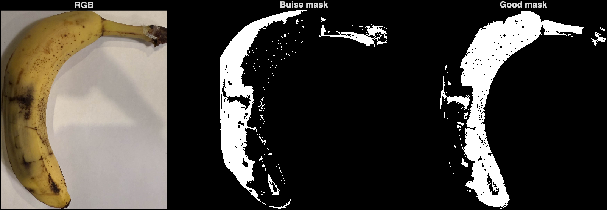

# Banana Bruise Detection

A MATLAB computer vision pipeline that classifies bananas as **OK** or **bruised** from a photo,
using color segmentation to measure healthy and bruised peel and a k-nearest-neighbors classifier
to make the call. A three-person team final project for ECET 369 at Purdue (Nov–Dec 2025).



## How it works

1. **Find the banana.** Convert to HSV and threshold on saturation (thresholds tuned in MATLAB's
   Color Thresholder app) to separate the banana from the background.
2. **Clean the mask.** Remove small blobs (`bwareaopen`), fill holes (`imfill`) and keep only the
   largest region (`bwareafilt`).
3. **Crop.** Use `regionprops` to find the banana's bounding box and crop to it.
4. **Segment the peel.** An RGB threshold marks brown, bruised pixels; banana pixels outside that
   mask count as good peel.
5. **Extract features.** Each banana becomes two numbers: its good-pixel count and its
   bruised-pixel count.
6. **Classify.** A 3-nearest-neighbors vote (`knnsearch`) against the labeled training bananas
   decides OK or bruised.

## Running it

Open the folder in MATLAB (requires the Image Processing and Statistics and Machine Learning
toolboxes) and run:

```matlab
final_project
```

It prints a prediction for each test image, the accuracy on the test and training sets, and plots
the training and test bananas in feature space.

## Data

10 photos in `images/`: 5 good and 5 bruised bananas. Images 1–3 of each are used for training
and 4–5 for testing.

## Results

| Set | Correct | Accuracy |
| --- | --- | --- |
| Test (4 images) | 3 / 4 | 75% |
| Training, leave-one-out (6 images) | 3 / 6 | 50% |

The classifier reliably recognizes good bananas but often misses bruised ones: on the training set
it labeled every bruised banana as OK.

## Limitations and next steps

- **The bruise threshold catches shading.** As the example above shows, darker, shadowed areas of
  yellow peel fall inside the bruise mask, so good and bruised bananas end up with similar counts.
  A threshold in HSV or Lab, or one that adapts to lighting, should separate them better.
- **Raw pixel counts depend on image scale.** A banana that fills more of the frame has more of
  every kind of pixel. Using the bruised fraction of the banana's area as the feature would remove
  that effect.
- **The dataset is tiny.** Six training images aren't enough to judge the method; more photos under
  consistent lighting would make the accuracy numbers meaningful.

## Files

| File | Contents |
| --- | --- |
| `final_project.m` | The full pipeline, with helper functions at the bottom |
| `images/` | Training and test photos |
| `example.png` | Example segmentation output |
| `ECET369FinalProject.drawio(.png)` | Flowchart of an earlier, threshold-only version of the design |
